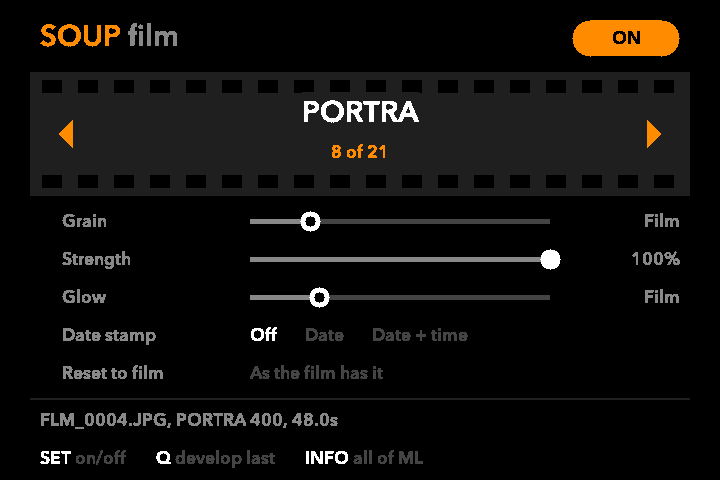
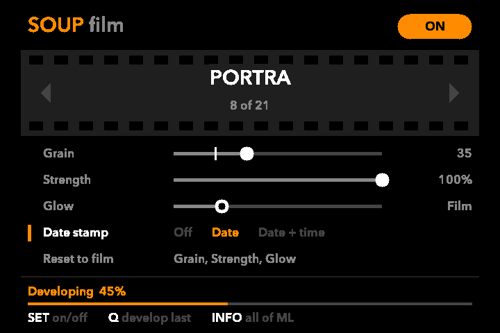

# Soup Film for the Canon EOS 1100D

A film simulator that runs inside the camera. After every shot, the camera
develops a copy of the photo through a film stock and saves it next to the
original as `FLM_xxxx.JPG`, with the same number. The original is never
touched.

It is a [Magic Lantern](https://github.com/reticulatedpines/magiclantern_simplified)
module built on [Soup Engine](https://github.com/jiijii0/soup-engine), for the
**EOS 1100D (Rebel T3 / Kiss X50) on Canon firmware 1.0.5**.



> [!WARNING]
> **Use at your own risk.** This is an unofficial, hobby project, not made or
> supported by Canon or by the Magic Lantern team.
>
> - Magic Lantern changes how your camera starts up. It could damage the
>   camera or void its warranty.
> - Soup Film has only been tried briefly, on one 1100D. Expect bugs.
> - Only for the **1100D on firmware 1.0.5**. Don't try it on any other camera.
> - Copy your photos off the card first, and use a fully charged battery. A
>   battery dying during the install is the main way to damage the camera.
> - Developing keeps the camera awake for about 45 s a shot, so the battery
>   runs down faster.
> - No warranty of any kind (see [LICENSE](LICENSE)). If something goes
>   wrong, you're on your own.
>
> Read Magic Lantern's own README in `sdcard/ML/README` before you install it.

## What it does

- **21 film stocks**: Portra, Ektar, Gold, Ultramax, Kodachrome, E100,
  Velvia, Provia, Astia, Superia, Cine 800T, Classic Chrome and others. The black
  and white ones (Acros, Tri-X, HP5) are listed last as **BW**.
- **Grain**, **Strength** (how much of the stock's colour) and **Glow**
  (halation), each on a slider.
- **Date stamp**: the orange seven-segment date of a film camera's back, in
  the corner, from the photo's own date and time. On black and white stocks it
  comes out grey, as it would on real film.
- **Half size.** Film copies are about 2136×1424 and take about 45 s a frame
  on the 1100D. Full size doesn't work on the 1100D yet.
- Shoot as usual. Frames queue up and develop one after another. A develop
  cut off by power-off is redone the next time the camera starts.
- The film copy keeps the original's camera, date, exposure and ISO in its
  EXIF.

## Installing

You need an SD card of 32 GB or less, a fully charged battery, and the camera
on firmware **1.0.5** (**Menu → Firmware Ver.**). Cameras on 1.0.6 have to go
back to 1.0.5 first, by flashing Canon's own 1.0.5 firmware file the same way
as step 3. That file is not included here.

1. Format the card in the camera.
2. Copy everything inside `sdcard/` to the root of the card: `autoexec.bin`,
   `ML-SETUP.FIR` and the `ML` folder.
3. Put the card back in, set the mode dial to **M**, open **Menu → Firmware
   Ver.** and start the update. This runs Magic Lantern's installer, which
   makes the card bootable. Follow its screen, then restart the camera.
4. Press **Trash** to open Magic Lantern's menu. Under **Modules**, set `soup`
   to load on startup, and restart.
5. From now on **Trash** opens the film screen. Pick a stock and press **SET**
   so the top right says **ON**.

To uninstall Magic Lantern, run `ML-SETUP.FIR` again from the firmware menu.

### Nicer fonts (optional, on a Mac)

The screen in the pictures uses Avenir Next. Fonts like that can't be shared in
this repository, but you can make them from fonts already on your Mac:

```sh
fonts/make-fonts.sh
```

Then copy `SOUP24.RBF` and `SOUP40.RBF` from `sdcard/ML/fonts/` to `ML/fonts`
on the card. You can pass any installed font, for example
`fonts/make-fonts.sh Futura-Medium`. Without these files the screen uses Magic
Lantern's own fonts.

## The film screen

| Key | Does |
|---|---|
| Up / Down | Pick a row |
| Left / Right, top dial | Change it |
| SET | Developing on or off; on Reset to film, resets |
| Q | Develop the last shot again, now |
| INFO | Magic Lantern's full menu |
| Trash, MENU | Close |

Grain and Glow start at the stock's own amount, shown as **Film**. When a
slider passes that amount it stops there, so the stock's default is easy to
find again. **Reset to film**, the last row, puts Grain, Strength and Glow
back to how the selected stock has them: select it and press **SET**.



## Making your own stocks

Stocks are plain text files in `ML/FILM/`, listed in `ML/FILM/INDEX.TXT`. The
camera reads 8.3 file names only, so a stock file's name has to be at most
8 characters plus `.fs`. The comments in the bundled stocks explain each
control.

## Building

```sh
./build.sh
```

Needs git and Docker. It checks out Magic Lantern at the commit this was
built against, copies `module/` in as `modules/soup`, builds both for the
1100D, and writes the SD card files to `sdcard/`. Magic Lantern itself is not
modified.

The module has a desktop test suite that develops a real photo through every
stock and simulates the card watcher. You provide a 6000×4000 JPEG, for
example a resized photo of your own:

```sh
module/tests/host/run.sh path/to/test.jpg
```

## Layout

| Path | What |
|---|---|
| `module/soup.c` | The camera side: watcher, develop, date stamp, film screen |
| `module/engine/` | Soup Engine, unchanged from upstream |
| `module/film/` | The film stocks |
| `module/tests/host/` | Desktop tests and a renderer for the film screen |
| `module/tools/mkrbf.swift` | Turns a macOS font into Magic Lantern's font format |
| `sdcard/` | A ready-built card for the 1100D |
| `fonts/make-fonts.sh` | Makes the optional screen fonts |

## Known limits

- Only tested on one 1100D, shooting JPEG. Developing from RAW (CR2) works in
  the desktop tests but is untested on the camera.
- Developing uses the full-size JPEG the camera makes, not the sensor data.
- The camera may not take a new shot while a frame is developing.

## Credits and licence

See [CONTRIBUTORS.md](CONTRIBUTORS.md). Everything here is under the GNU
General Public License version 2 ([LICENSE](LICENSE)), like Magic Lantern and
Soup Engine.

The port to Magic Lantern and the film screen were written with an AI model
(Claude, by Anthropic). Magic Lantern's
[LLM policy](https://github.com/reticulatedpines/magiclantern_simplified/blob/dev/LLM_POLICY.md)
does not accept substantial LLM-written code, so this module is a separate
project and is not meant for Magic Lantern upstream.

Film names such as Kodachrome, Portra, Velvia, Acros, Tri-X and HP5 are
trademarks of their owners. The stocks are imitations of how those films look,
and this project has no connection to Kodak, Fujifilm, Ilford or Canon.
